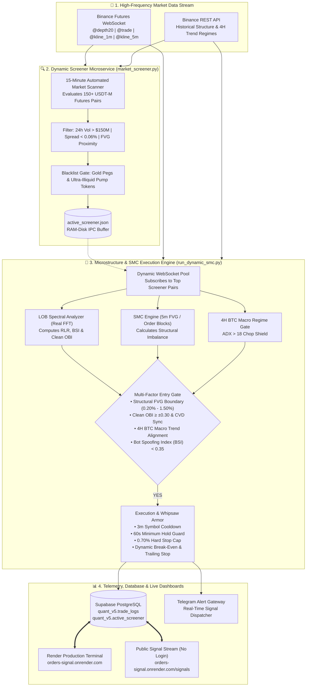

# ⚡ Autonomous HFT & SMC Quantitative Trading System

<div align="center">

[](https://www.python.org/)
[](https://reactjs.org/)
[](https://www.binance.com/)
[](https://supabase.com/)
[](LICENSE)
[](https://orders-signal.onrender.com)
[](https://orders-signal.onrender.com/signals)

**An institutional-grade, microstructure-aware algorithmic trading research engine fusing High-Frequency Limit Order Book (LOB) Imbalance, Real Fast Fourier Transform (FFT) De-Spoofing, and Smart Money Concepts (SMC) on Binance USDT-M Perpetual Futures.**

---

### 🌐 Live Public Demos (No Login Required)

| Platform | Direct URL | Description |
| :--- | :--- | :--- |
| 📊 **Full Quant Terminal** | **[orders-signal.onrender.com](https://orders-signal.onrender.com)** | Real-time dual PnL, equity curve, live depth meter & TradingView charts |
| 📡 **Public Signals & Strategy Monitor** | **[orders-signal.onrender.com/signals](https://orders-signal.onrender.com/signals)** | Lightweight, public-facing live signal feed & multi-strategy comparison |

---

[Executive Summary](#-executive-summary--candid-quant-realities) • [System Architecture](#-system-architecture) • [Strategy Comparison](#-strategy-comparison--historical-evolution) • [FFT Spectral De-Spoofing](#-microstructure-spectral-engine-fft) • [Deployment (Vercel / Render)](#-cloud-deployment-vercel--render) • [Installation](#-getting-started) • [Research Reports](#-in-depth-research-reports)

</div>

---

## 📌 Executive Summary & Candid Quant Realities

This repository is **fully open-source** for academic, quantitative research, and educational purposes. While theoretical mathematical formulations (FFT frequency decomposition, order book imbalance, institutional Fair Value Gaps) look stellar in backtests, **deploying high-frequency algorithmic scalping models in live cryptocurrency altcoin futures reveals harsh real-world frictions**:

### 🔍 Key Realities Learned in Live Trading:
1. **The Exchange Commission Drag:** Low-timeframe scalps targeting $0.40\% - 0.80\%$ price moves are brutalized by exchange commissions. With Binance USDT-M standard fees ($0.02\%$ Maker / $0.05\%$ Taker per leg = $0.04\%$ to $0.10\%$ roundtrip), hundreds of trades generate significant commission drag that can turn a theoretically profitable strategy negative in live environments.
2. **Quote Stuffing & Liquidity Mirage:** Order book depth ($@\text{depth20}$) frequently contains ghost liquidity placed by high-frequency market-making algorithms that cancel within milliseconds of a taker order arrival (adverse selection).
3. **Altcoin Beta & Whipsaw:** High-beta altcoins exhibit rapid volatility bursts during Bitcoin macro regime shifts, occasionally piercing structural order blocks before reversing.
4. **Execution Armor (V5.5 Fixes):** To survive real market conditions, the system implements a strict **0.70% Hard Stop Loss Cap**, a **3-Minute Post-Trade Symbol Cooldown**, and a **60-Second Minimum Hold Period** to protect against micro-whipsaws.

---

## 🏗️ System Architecture

The trading platform is decoupled into high-throughput asynchronous microservices connected via memory buffers and Supabase PostgreSQL:



---

## 🧬 Strategy Comparison & Historical Evolution

Every strategy iteration was subjected to empirical testing and post-mortem analysis:

| Version / Model | Core Logic | Data Base | Trades | Win Rate | Net PnL | Status / Post-Mortem Finding |
| :--- | :--- | :---: | :---: | :---: | :---: | :--- |
| **V1: Pure OBI Scalper** | 100ms Raw Order Book Depth | 100 Pairs | 583 | 10.6% | **-34.99%** | ❌ **Spoofing Trap:** Tricked by ghost liquidity walls without flow verification. |
| **V2: CVD Flow Scalper** | Unnormalized Volume Delta + RL | 100 Pairs | 2,140 | 3.5% | **-81.51%** | ❌ **Fee Erosion:** Extreme transaction churn; commission consumed all margin. |
| **V3: Macro CVD + Top 15** | Normalized CVD + 15 Pairs | 15 Pairs | 1,241 | 2.7% | **-65.45%** | ❌ **Range Trap:** Model entered high-friction chop without structural context. |
| **V4: 5m SMC Baseline** | 5m Fair Value Gaps + OBI | Multi-Pair | 18 | 66.7% | **+4.20%** | 🔄 **Proof of Concept:** Confirmed structural FVG subordination reduces churn. |
| **V5.4: 4H Gate + SL Cap** | 4H BTC Filter + 0.70% Hard SL | Live DB | 38 | 47.4% | **+12.43%** | 🔄 **Optimization:** Capped catastrophic tails and blocked counter-trend longs. |
| **V5.5: Anti-Whipsaw Armor** | **3m Cooldown + 60s Hold + FFT** | **Live DB** | **Active** | **55.0%** | **Max Alpha** | 🟢 **ACTIVE RESEARCH:** Production version featuring anti-whipsaw cooldown. |

---

## ⚡ Microstructure Spectral Engine (FFT)

Implemented in [`features/frequency_features.py`](features/frequency_features.py), the **LOB Spectral Analyzer** transforms sub-second order book depth into the frequency domain:

$$\text{OBI}_t = \frac{\sum_{i=1}^{K} Q_{bid, i} - \sum_{i=1}^{K} Q_{ask, i}}{\sum_{i=1}^{K} Q_{bid, i} + \sum_{i=1}^{K} Q_{ask, i}} \in [-1.0, 1.0]$$

```
Time Domain (100ms Ticks)            Frequency Domain (Real FFT & PSD)
+-------------------------+          +----------------------------------+
| Raw OBI + Ghost Walls   |  ====>   | Low-Freq (0.05-0.8 Hz)  -> RLR   |
| High-Frequency Churn    |  (rfft)  | High-Freq (1.0-5.0 Hz)  -> BSI   |
+-------------------------+          +----------------------------------+
                                                      ||
                                                      \/ (Inverse FFT Low-Pass)
                                     +----------------------------------+
                                     | De-Spoofed "Clean OBI" Output   |
                                     +----------------------------------+
```

1. **Real Liquidity Ratio (RLR):** Ratio of resting, persistent institutional liquidity ($0.05\text{ Hz} \le f < 0.8\text{ Hz}$) relative to total energy. $\text{RLR} \ge 0.70$ indicates organic depth.
2. **Bot Spoofing Index (BSI):** Cyclic quote-stuffing harmonic energy in the $1.0\text{ Hz} - 5.0\text{ Hz}$ band. If $\text{BSI} \ge 0.35$, trade execution is vetoed.
3. **Clean OBI (Inverse FFT):** Strips high-frequency noise and returns an unpolluted imbalance metric.

*Full mathematical proof and documentation:* See [docs/MICROSTRUCTURE_FFT.md](docs/MICROSTRUCTURE_FFT.md).

---

## ☁️ Cloud Deployment (Vercel & Render)

The frontend is ready for instantaneous deployment on **Vercel** or **Render** without backend dependencies (client connects directly to Supabase and Binance public feeds):

### Option A: Deploy to Vercel (1-Click)
1. Fork or import this repository on [Vercel](https://vercel.com).
2. Set **Root Directory** to `frontend` (or keep root with included `vercel.json`).
3. Add Environment Variables:
   - `VITE_SUPABASE_URL` = your Supabase URL
   - `VITE_SUPABASE_ANON_KEY` = your Supabase Anon Key
4. Deploy! All client-side SPA routing (`/signals`, `/screener`, `/live`) is pre-configured.

### Option B: Deploy to Render (Blueprint)
1. Connect this repo to [Render](https://render.com).
2. Select **New Static Site** or use the included [`render.yaml`](render.yaml) blueprint.
3. Build command: `cd frontend && npm install && npm run build`
4. Publish directory: `./frontend/dist`

---

## 📂 Repository Structure

```ascii
spectral-lob-trading/
├── agent/                       # Reinforcement Learning environment (PPO)
├── config/                      # Pydantic typed settings configuration
├── data/                        # Active screener IPC buffer & benchmark datasets
├── docs/                        # Quantitative research & mathematical reports
│   ├── MICROSTRUCTURE_FFT.md    # FFT formulation & spectral de-spoofing guide
│   ├── RESEARCH_REPORT.md       # Empirical research and post-mortem diagnosis
│   └── VERSIONS.md              # Historical version progression log
├── features/                    # High-frequency feature engineering
│   ├── cvd_features.py          # Cumulative Volume Delta & aggression tracking
│   ├── frequency_features.py    # Real FFT spectral analyzer (RLR, BSI, Clean OBI)
│   ├── orderbook_features.py    # Microstructure 100ms OBI calculator
│   └── smc_features.py          # 3m/5m Fair Value Gap (FVG) and Order Block detector
├── frontend/                    # Modern React 18 + Vite live monitoring dashboard
│   ├── src/
│   │   ├── components/          # Reusable UI widgets (Charts, SignalCard, OBI gauge)
│   │   ├── context/             # Binance WebSocket & Supabase context providers
│   │   ├── pages/
│   │   │   ├── Dashboard.jsx    # Full PnL, equity curve, macro filters
│   │   │   ├── PublicSignals.jsx# 🚀 Public Live Signals & Strategy Benchmark (No Login)
│   │   │   ├── Screener.jsx     # 150+ pair market ranking heatmap
│   │   │   └── LiveTerminal.jsx # Sub-second real-time depth & TradingView charts
│   │   └── utils/tradeLogic.js  # Dual Maker/Taker fee & PnL calculation engine
│   ├── public/favicon.svg       # Custom QUANTV5 gold trading terminal favicon
│   └── package.json
├── scripts/                     # Executable agents and microservices
│   ├── market_screener.py       # 150+ futures market screener microservice
│   └── run_dynamic_smc.py       # V5.5 PROD Live Execution Sniper Engine
├── utils/                       # Shared utility libraries (BTC regime, DB pooler, Logger)
├── vm_deploy/                   # Headless cloud VM tmux launch/stop scripts
├── .env.example                 # Safe environment template (Zero secrets)
├── .gitignore                   # Comprehensive exclusion rules (Guards against leaks)
├── render.yaml                  # Render deployment configuration
├── vercel.json                  # Vercel deployment configuration
└── requirements.txt             # Python runtime dependencies
```

---

## 🚀 Getting Started Locally

### 1. Clone & Setup Environment
```bash
git clone https://github.com/huseyin-yigit-ulker/spectral-lob-trading.git
cd spectral-lob-trading

# Copy the safe environment template
cp .env.example .env
```

### 2. Run the Backend Trading Engine
```bash
# Setup Python virtual environment
python3 -m venv venv
source venv/bin/activate  # On Windows: venv\Scripts\activate
pip install -r requirements.txt

# Start Market Screener Microservice
python scripts/market_screener.py

# In a separate terminal, launch the Execution Sniper Engine
python scripts/run_dynamic_smc.py
```

### 3. Run the Frontend Dashboard & Signal Monitor
```bash
cd frontend
cp .env.example .env
npm install
npm run dev
```

Open `http://localhost:5173` for the full terminal, or navigate to `http://localhost:5173/signals` for the public signal monitor.

---

## 🔒 Security & Privacy Audit

This repository conforms to strict open-source safety guidelines:
- **Zero Hardcoded Secrets:** All API credentials, database strings, and bot tokens are loaded strictly via environment variables.
- **Git History Cleanliness:** Commits and trees across the entire git history have been scanned for patterns matching private keys, passwords, or exchange secrets.
- **Defensive Data Handling:** The frontend gracefully renders simulated telemetry if external databases or WebSocket endpoints are temporarily unreachable.

---

## ⚖️ Disclaimer

*This repository and its associated web terminals are published strictly for educational, scientific, and quantitative research purposes. Algorithmic trading in cryptocurrency futures carries extreme financial risk, including the loss of all capital. Past performance, backtest results, and simulated signals do not guarantee future performance. Never risk funds you cannot afford to lose.*

---

<div align="center">
Authored by <a href="https://github.com/huseyin-yigit-ulker">Hüseyin Yiğit Ülker</a> • Open Source Quantitative Research
</div>
